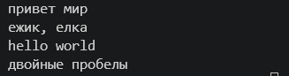
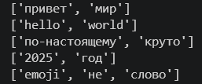
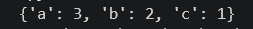
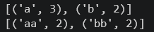
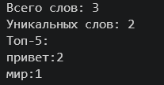

# Упражнение А

## Функция normalize

``` 
def normalize(text: str, *, casefold: bool = True, yo2e: bool = True) -> str:
    if casefold:
        text = text.casefold()
    else:
        text = text.lower()

    if yo2e:
        text = text.replace("ё", "е").replace("Ё", "Е")

    text = " ".join(text.split())

    return text
```

Выход тест-кейсов:

   
   


## Функция tokenize
```
import re

def tokenize(text: str) -> list[str]:
    pattern = r"\w+(?:-\w+)*"
    return re.findall(pattern, text)
```

Выход тест-кейсов:

   
   


## Функция count_freq
```
from collections import Counter

def count_freq(tokens: list[str]) -> dict[str, int]:
    return dict(Counter(tokens))
```

Выход тест-кейсов:

   
   


## Функция top_n
```
def top_n(freq: dict[str, int], n: int = 5) -> list[tuple[str, int]]:
    sorted_items = sorted(freq.items(), key=lambda item: (-item[1], item[0]))
    return sorted_items[:n]
```

Выход тест-кейсов:

   
   


# Упражнение B

```
import sys

from src.lib.text.normalize import normalize
from src.lib.text.tokenizer import tokenize
from src.lib.text.count_freq import count_freq
from src.lib.text.top_n import top_n

text = sys.stdin.read()

tokens = tokenize(normalize(text))
freq = count_freq(tokens)
top5 = top_n(freq, 5)

print(f"Всего слов: {len(tokens)}")
print(f"Уникальных слов: {len(freq)}")
print("Топ-5:")

for w, c in top5:
    print(f"{w}:{c}")
```

## Обьяснение кода:

Импортируем написанные ранее функции из задания А. Считываем текст через stdin, нормализуем текст и токенезируем его. Считываем частоту слов, отбираем топ 5 самых частых слов, выводи результат.

Вывод результата:

