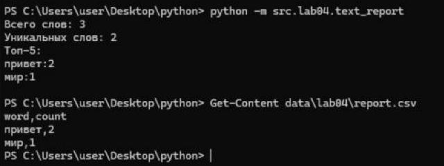
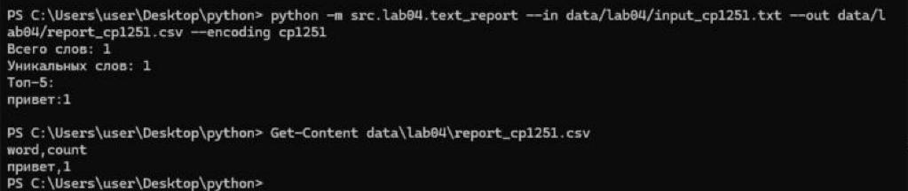
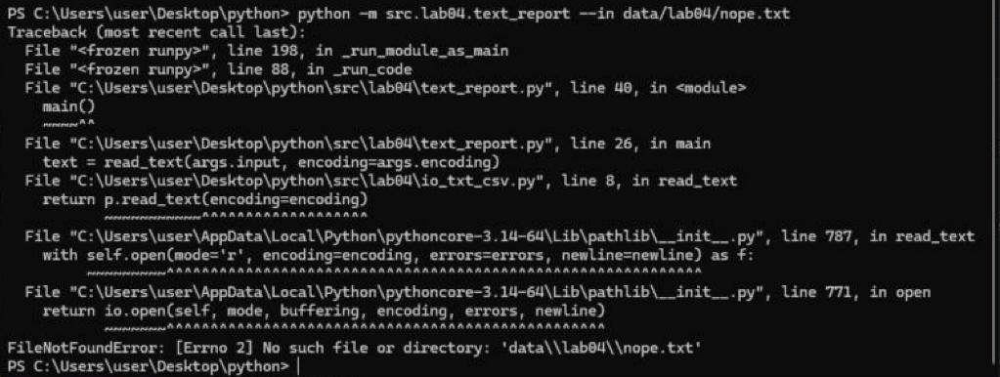
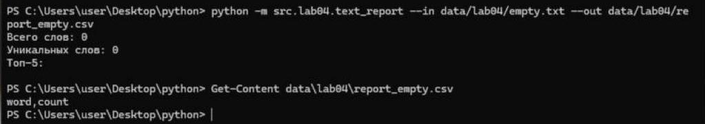

# Лабораторная работа 4

## Задание A

### Функция read_text

Читает файл целиком и возвращает его содержимое одной строкой, пустой файл дает пустую строку, если файла нет то ошибка FileNotFoundError, если кодировка не подходит то ошибка UnicodeDecodeError

### Функция write_csv

Создает или перезаписывает CSV-файл с разделителем `,`, если передан header то он пишется первой строкой,  если строки в rows разной длины то ошибка ValueError

### Функция ensure_parent_dir

Создаёт папку для файла если её ещё нет, вызывается внутри функции write_csv


## Задание B
Код читает текстовый файл, нормализует и токенизирует текст функциями из ЛР3, считает частоты слов и сохраняет отчёт в CSV

### Результаты запуска:
Обычный запуск:




Кодировка cp1251:




Файла нет:





### Команды запуска

Запуск выполняется из корня проекта:

```
python -m src.lab04.text_report
```
Читает `data/lab04/input.txt` и отвечает в `data/lab04/report.csv`

```
python -m src.lab04.text_report --in data/lab04/a.txt --out data/lab04/out.csv
```
Читает и пишет файлы, указанные в параметрах.

Параметры:
--in - какой файл читать, изначально: `data/lab04/input.txt`
--out - куда сохранять CSV, изначально: `data/lab04/report.csv`
--encoding - кодировка входного файла, изначально: `utf-8`

### Кодировки

Входной файл читается в UTF-8, если файл сохранён в другой кодировке например, в cp1251, её нужно передать через параметр --encoding:

```
python -m src.lab04.text_report --in data/lab04/input_cp1251.txt --encoding cp1251
```

### Политика для пустого входа

Если входной файл пустой, то report.csv содержит только заголовок `word,count`, в консоли выводится, что всего слов 0 и что уникальных слов тоже 0, а список топ 5 пустой
