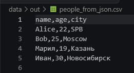
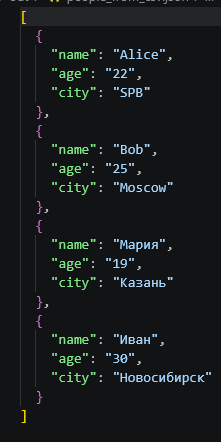
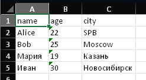

# Лабораторная работа 5

## Задание A

### Функция check_file

Вспомогательная функция, делает 3 проверки, проверяет правильное ли расширение, проверяет существованеи файла, проевряет, что данный обьект файл а не папка

### Функция json_to_csv

Из формата JSON делает формат CSV, в ходе работы проходит 5 основных этапов, 1 - проверяет файл с помощью check_file, 2 - прочитывает JSON и создает список словарей, 3 - проверяет список на пустоту,  а также что в нем только словари, 4 - собирает все ключи словарей(название колонок), 5 - записывает CSV

### Функция csv_to_json

Из формата CSV делает формат JSON, в ходе работы проходит 4 основных этапа, 1 - проверяет файл с помощью check_file, 2 - прочитывает CSV первая строка - ключи, остальные - словари, 3 - проверяет, что данные не пустые, 4 - записывает список словарей в JSON

## Задание B

### Функция csv_to_xlsx

Из файла CSV делает файл Excel, в ходе работы проходит 7 основных этапов, 1 - проверяет файл на расширение и на существование, 2 - прочитывает CSV каждая строка - список значений, 3 - проверяет, что файл не пустой, 4 - создает Workbook и называет лист Sheet1, 5 - переносит все строки в лист, 6 - рассчитывает ширину для каждой колонки отдельно, 7 - сохраняет .xlsx

