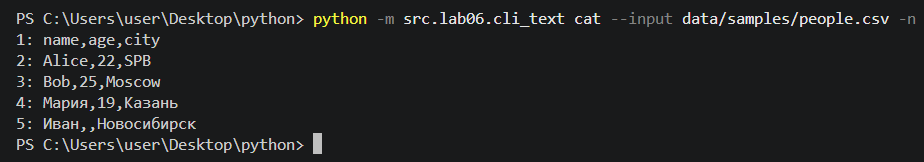
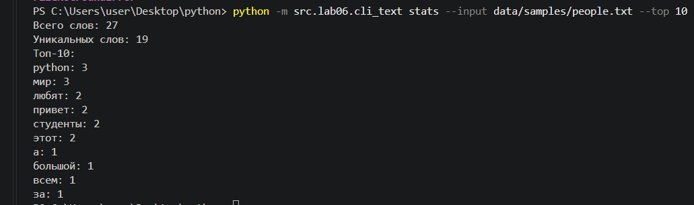
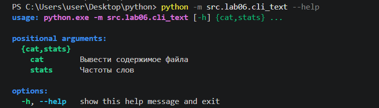
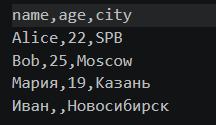
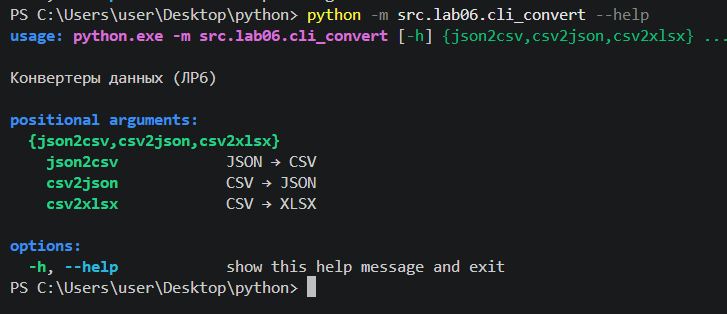

# Лабораторная работа 6

## Задание Подкоманды в одном CLI

### Функция cat

Функция cat выводит файл построчно, делаем проверку на существование файла, открываем, читаем и закрываем файл с помощью with as, перебираем строки, вводим нумерацию, начинаем  с 1, если указано во флаге включаем нумерацию

### Функция stats

Функция cat выводит топ самых частых слов, делаем проверку на существование файла, открываем, читаем и закрываем файл с помощью with as, нормализуем, токенизируем слова и их считаем

### --help

### Функция main

Функция main является функцией где собран весь запуск програмы, создаем парсер, указываем команды и подкоманды, считываем что введено в терминале, вызываем нужную функцию

## Задание  CLI‑конвертер

### Функция main

Функция main является функцией где собран весь запуск програмы, создаем парсер, указываем команды и подкоманды, считываем что введено в терминале, вызываем нужную функцию

### --help

